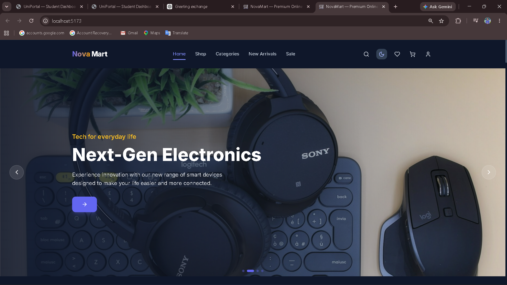
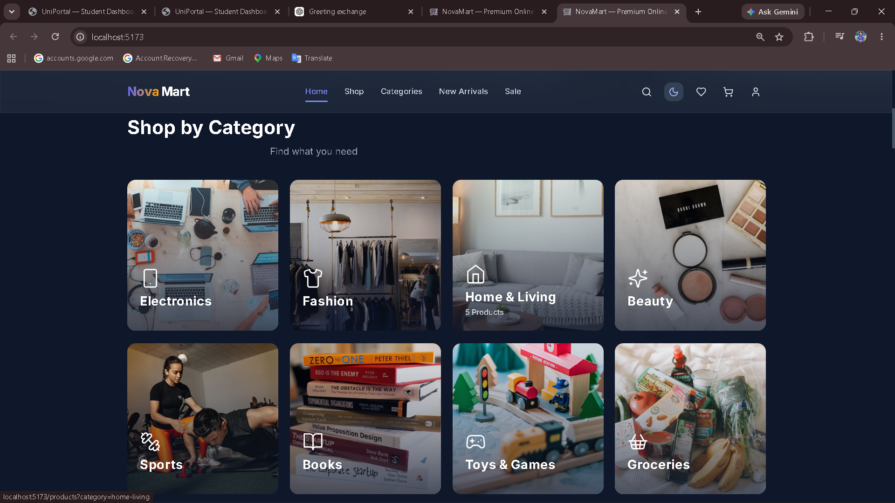
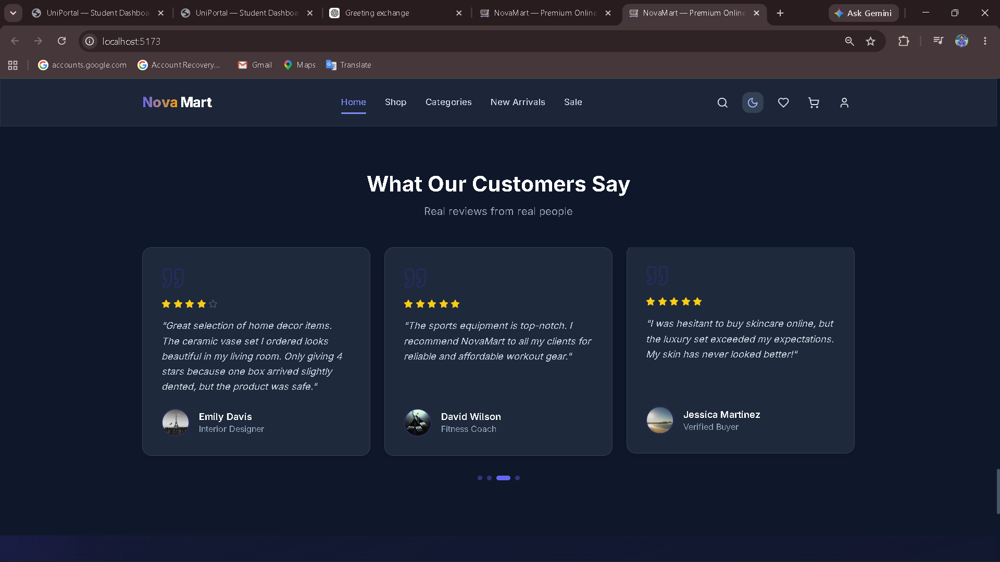
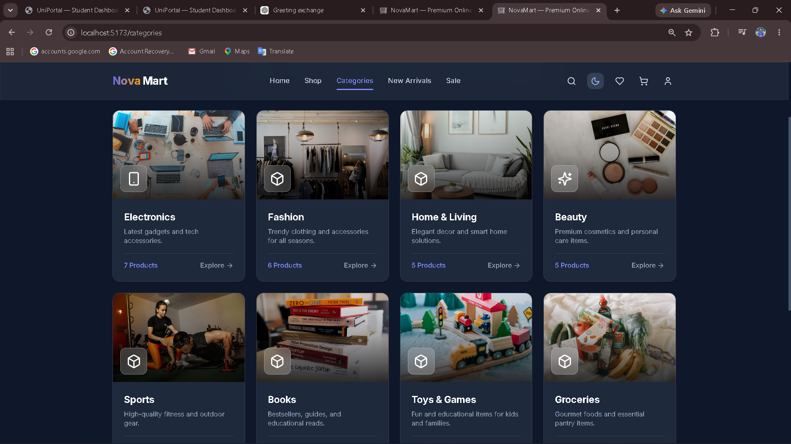
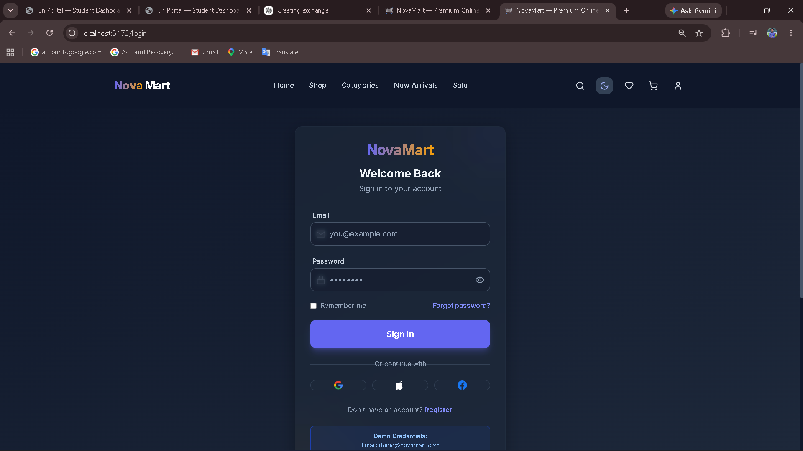
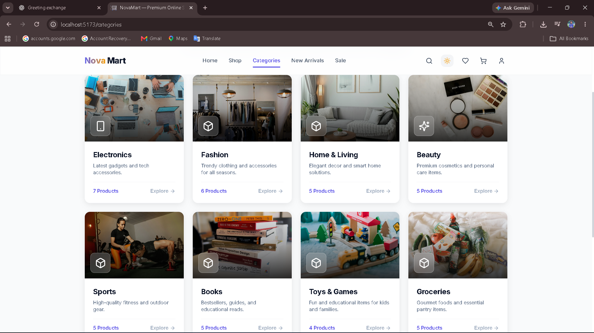
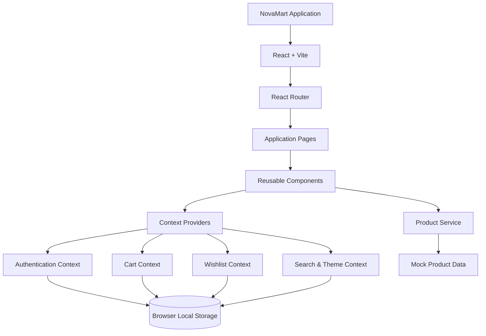

# 🛍️ NovaMart — Premium Online Shopping Experience

<p align="center">
  <strong>A Modern, Responsive E-Commerce Storefront</strong>
</p>

<p align="center">
  Discover products, explore categories, save favorites, manage your cart, and enjoy a seamless online shopping experience.
</p>

<p align="center">
  <a href="#-screenshots">Screenshots</a> •
  <a href="#-features">Features</a> •
  <a href="#-technology-stack">Technology Stack</a> •
  <a href="#-getting-started">Getting Started</a>
</p>

<p align="center">
  
  
  
  
  
</p>

---

## ✨ Overview

**NovaMart** is a frontend-focused e-commerce web application designed to provide a modern and engaging online shopping experience.

Built with React, Vite, and Tailwind CSS, the application brings together product discovery, category browsing, search, filtering, wishlist management, shopping cart functionality, discount coupons, checkout, and order history.

The application uses reusable React components, Context API for shared state management, Framer Motion for animations, and browser Local Storage for client-side persistence.

NovaMart demonstrates how a modern e-commerce storefront can be organized into reusable components and interactive shopping workflows without requiring a backend database.

## 🚀 Features

### 🛍️ Shopping Experience

- 🏠 Modern e-commerce homepage
- 🔍 Product search
- 🎯 Product filtering and sorting
- 🗂️ Category-based product browsing
- 📦 Detailed product pages
- 🖼️ Product image galleries
- ⚡ Product quick-view modal
- ❤️ Wishlist management
- 🛒 Shopping cart management
- 🎟️ Coupon code support
- 💳 Multi-step checkout interface
- ✅ Order confirmation
- ⭐ Product reviews and ratings
- 📱 Responsive shopping experience

### 🏷️ Storefront Features

- ⚡ Flash sale section
- 🔥 Best-selling products
- ✨ Featured products
- 🆕 New arrivals
- 🗂️ Eight product categories
- 🎁 Promotional sections
- 📧 Newsletter section
- 💬 Customer testimonials
- 🔔 Toast notifications

### 📂 Product Categories

NovaMart includes sample products across eight categories:

| Category | Description |
|---|---|
| 📱 Electronics | Gadgets and technology accessories |
| 👕 Fashion | Clothing and accessories |
| 🏠 Home & Living | Home decor and lifestyle products |
| 💄 Beauty | Cosmetics and personal care |
| 🏋️ Sports | Fitness and outdoor equipment |
| 📚 Books | Educational books and bestsellers |
| 🎮 Toys & Games | Entertainment and educational products |
| 🛒 Groceries | Food and everyday essentials |

### ❤️ Wishlist

- Save favorite products
- View saved products
- Remove individual wishlist items
- Move products to the shopping cart
- Persist wishlist data using Local Storage

### 🛒 Shopping Cart

- Add products to the cart
- Update product quantities
- Remove individual products
- Calculate subtotal
- Apply discount coupons
- Calculate shipping and tax
- Display the final order total
- Preserve cart data between browser sessions

### 🎟️ Coupon System

NovaMart includes predefined demonstration coupon codes.

| Coupon | Discount | Minimum Order |
|---|---|---|
| `SAVE10` | 10% off | $50 |
| `SAVE20` | 20% off | $100 |
| `FLAT15` | $15 off | $75 |
| `WELCOME` | 15% off | No minimum |
| `FREESHIP` | $10 shipping discount | $30 |

Coupon eligibility is determined by the configured minimum order amount.

### 👤 Authentication & Profile

NovaMart provides a client-side demonstration authentication workflow.

- Demo login
- User registration
- Logout
- Profile management
- Client-side user persistence
- Order history associated with the current user

> Authentication is implemented for demonstration purposes using browser-side application state and Local Storage. It is not production-grade server-side authentication.

### 💳 Checkout Experience

The application includes a multi-step checkout interface.

- Shipping information
- Order summary
- Payment method selection
- Checkout validation
- Order confirmation
- Order history

**Available demonstration payment options:**

- Credit Card
- PayPal
- Apple Pay

> ⚠️ Payment processing is simulated. No real transactions, payment gateway requests, or financial processing take place.

### 🌙 UI / UX

- Light and dark themes
- Responsive layouts
- Mobile navigation
- Smooth page transitions
- Hover interactions
- Glassmorphism-inspired elements
- Gradients and soft shadows
- Rounded product cards
- Skeleton loading components
- Reusable UI components
- Toast notifications
- Framer Motion animations

## 📸 Screenshots

Explore NovaMart's shopping interface and major application sections.

### 🏠 Homepage

<p align="center">
  
</p>

### 🗂️ Category Showcase

<p align="center">
  
</p>

### 💬 Customer Testimonials

<p align="center">
  
</p>

### 🛍️ Categories Page

<p align="center">
  
</p>

### 🔐 Login Experience

<p align="center">
  
</p>

### ☀️ Light Theme

<p align="center">
  
</p>

## 📄 Application Pages & Routes

NovaMart includes 16 application routes.

| # | Page | Route |
|---|---|---|
| 1 | Home | `/` |
| 2 | Products | `/products` |
| 3 | Product Details | `/product/:id` |
| 4 | Categories | `/categories` |
| 5 | Search Results | `/search` |
| 6 | Wishlist | `/wishlist` |
| 7 | Cart | `/cart` |
| 8 | Checkout | `/checkout` |
| 9 | Order Success | `/order-success` |
| 10 | Profile | `/profile` |
| 11 | Login | `/login` |
| 12 | Register | `/register` |
| 13 | Contact | `/contact` |
| 14 | About | `/about` |
| 15 | FAQ | `/faq` |
| 16 | Not Found | `*` |

## 🧰 Technology Stack

| Category | Technology |
|---|---|
| Frontend Library | React 18 |
| Build Tool | Vite 5 |
| Language | JavaScript / JSX |
| Styling | Tailwind CSS 3 |
| Routing | React Router 6 |
| Animations | Framer Motion 11 |
| Icons | Lucide React |
| Carousels | Swiper 11 |
| Notifications | React Hot Toast |
| State Management | React Context API |
| Client-side Storage | Browser Local Storage |
| CSS Processing | PostCSS |
| Vendor Prefixing | Autoprefixer |

## 🏗️ Application Architecture

NovaMart follows a component-based React architecture with shared context providers and service modules.



### State Management

NovaMart uses React Context API to share application state across components.

| Context | Responsibility |
|---|---|
| AuthContext | User state, registration, login and orders |
| CartContext | Cart items, quantities, coupons and totals |
| WishlistContext | Saved products and wishlist actions |
| SearchContext | Shared search state |
| ThemeContext | Light and dark theme preference |

### Client-Side Persistence

Application data is stored in the browser using Local Storage.

| Storage Key | Purpose |
|---|---|
| `novamart-user` | Current user session |
| `novamart-users` | Registered demonstration users |
| `novamart-orders` | Demonstration orders |
| `novamart-cart` | Shopping cart |
| `novamart-coupon` | Applied coupon |
| `novamart-wishlist` | Saved products |

This allows selected application state to remain available between browser sessions.

## 📂 Project Structure

```text
Mart-E-Commerce-Website/
│
├── screenshots/
│   ├── 01-homepage.png
│   ├── 02-category-showcase.png
│   ├── 03-customer-testimonials.png
│   ├── 04-categories-page.png
│   ├── 05-login.png
│   └── 06-categories-page-light.png
│
├── src/
│   ├── components/
│   │   ├── cart/
│   │   ├── checkout/
│   │   ├── common/
│   │   ├── home/
│   │   ├── layout/
│   │   └── product/
│   │
│   ├── context/
│   │   ├── AuthContext.jsx
│   │   ├── CartContext.jsx
│   │   ├── SearchContext.jsx
│   │   ├── ThemeContext.jsx
│   │   └── WishlistContext.jsx
│   │
│   ├── hooks/
│   │   ├── useDebounce.js
│   │   ├── useLocalStorage.js
│   │   └── useScrollToTop.js
│   │
│   ├── pages/
│   │   ├── About.jsx
│   │   ├── Cart.jsx
│   │   ├── Categories.jsx
│   │   ├── Checkout.jsx
│   │   ├── Contact.jsx
│   │   ├── FAQ.jsx
│   │   ├── Home.jsx
│   │   ├── Login.jsx
│   │   ├── NotFound.jsx
│   │   ├── OrderSuccess.jsx
│   │   ├── ProductDetails.jsx
│   │   ├── Products.jsx
│   │   ├── Profile.jsx
│   │   ├── Register.jsx
│   │   ├── SearchResults.jsx
│   │   └── Wishlist.jsx
│   │
│   ├── services/
│   │   └── productService.js
│   │
│   ├── styles/
│   │   └── index.css
│   │
│   ├── utils/
│   │   ├── constants.js
│   │   ├── helpers.js
│   │   └── mockData.js
│   │
│   ├── App.jsx
│   └── main.jsx
│
├── index.html
├── package.json
├── package-lock.json
├── postcss.config.js
├── tailwind.config.js
├── vite.config.js
└── README.md
```

## ⚙️ Getting Started

Follow these steps to run NovaMart locally.

### Prerequisites

Make sure you have installed:

- Node.js 18 or newer
- npm 9 or newer
- Git

Verify your installation:

```bash
node --version
npm --version
```

### 1. Clone the Repository

```bash
git clone https://github.com/injmam089/Mart-E-Commerce-Website.git
cd Mart-E-Commerce-Website
```

### 2. Install Dependencies

```bash
npm install
```

### 3. Start the Development Server

```bash
npm run dev
```

The Vite development server runs at:

```text
http://localhost:5173
```

### 4. Build for Production

```bash
npm run build
```

### 5. Preview the Production Build

```bash
npm run preview
```

## 📜 Available Scripts

| Command | Description |
|---|---|
| `npm run dev` | Start the Vite development server |
| `npm run build` | Build the application for production |
| `npm run preview` | Preview the production build |

## 🔐 Security & Demo Limitations

NovaMart is a frontend demonstration project rather than a production e-commerce platform.

Important limitations:

- No backend API or database is implemented.
- Authentication is handled on the client side.
- Demo user information is stored in Local Storage.
- Registered demonstration user data is not protected by server-side password hashing.
- Payment methods are simulated.
- Orders are stored locally in the browser.
- Product information comes from predefined mock data.
- Local Storage data can be modified by the user.

Do not use real customer information, actual payment card details, or production credentials with this demonstration application.

A production e-commerce system would require server-side authentication, secure password handling, database persistence, payment gateway integration, server-side order validation, and appropriate security controls.

## 🎨 Design System

NovaMart uses a modern storefront design system.

| Element | Design |
|---|---|
| Primary Color | Indigo |
| Accent Color | Amber |
| Typography | Inter |
| Dark Theme | Slate-based colors |
| UI Components | Rounded cards and controls |
| Visual Effects | Gradients and soft shadows |
| Animations | Framer Motion transitions |

## 📱 Responsive Design

The interface is designed to adapt to different screen sizes:

- 📱 Mobile devices
- 📲 Tablets
- 💻 Laptops
- 🖥️ Desktop screens

Responsive navigation, product grids, shopping cart views, and checkout forms support the browsing experience across devices.

## 🔮 Future Improvements

Potential areas for future development:

- [ ] Backend API integration
- [ ] PostgreSQL or MongoDB database
- [ ] Secure server-side authentication
- [ ] Real payment gateway integration
- [ ] Product administration dashboard
- [ ] Real-time order tracking
- [ ] Inventory management
- [ ] Cloud image storage
- [ ] Server-side order processing
- [ ] Automated testing
- [ ] CI/CD pipeline
- [ ] Production deployment

## 🎯 Project Highlights

NovaMart demonstrates practical frontend and React development concepts through:

- Component-based architecture
- React Context API
- Client-side routing
- Reusable UI components
- Responsive web design
- Product filtering and sorting
- Shopping cart logic
- Wishlist functionality
- Client-side demonstration authentication
- Local Storage persistence
- Coupon and discount logic
- Checkout workflow design
- UI animations and transitions
- Modern e-commerce user experience

## 👨‍💻 Author

**Injmam Ansari**

BCA Student | Cybersecurity & Software Development

<p>
  <a href="https://github.com/injmam089">
    
  </a>
</p>

---

<p align="center">
  <strong>🛍️ NovaMart — Premium Online Shopping Experience</strong>
  <br>
  If you find this project interesting, consider giving the repository a ⭐
</p>
